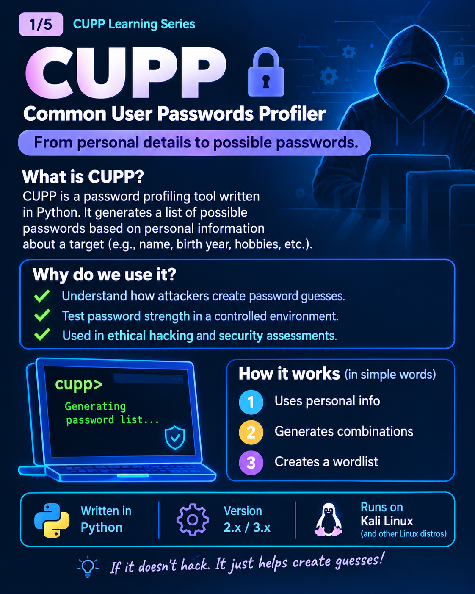
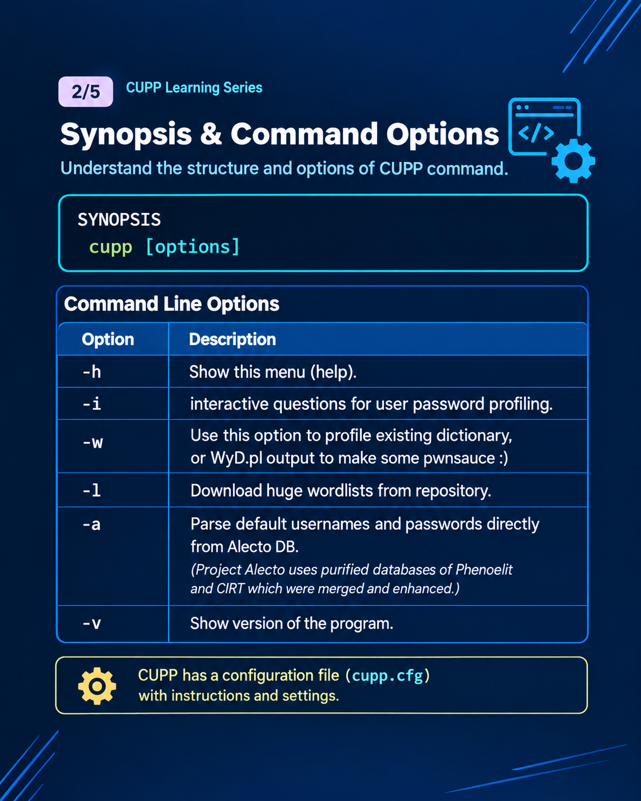
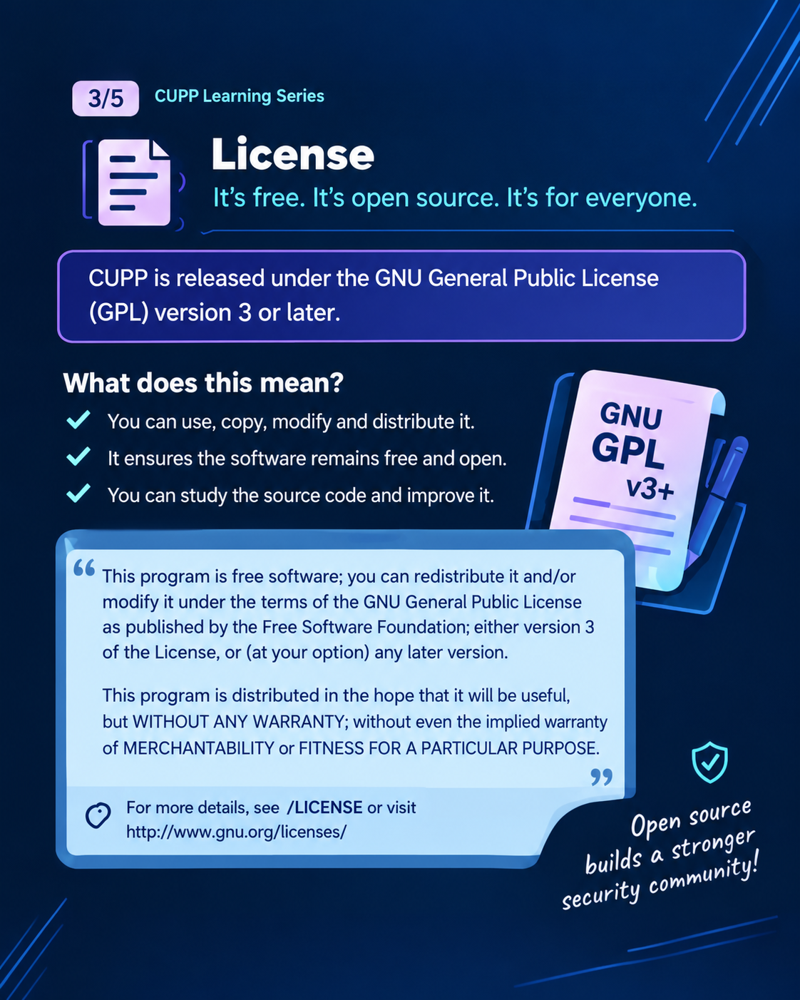
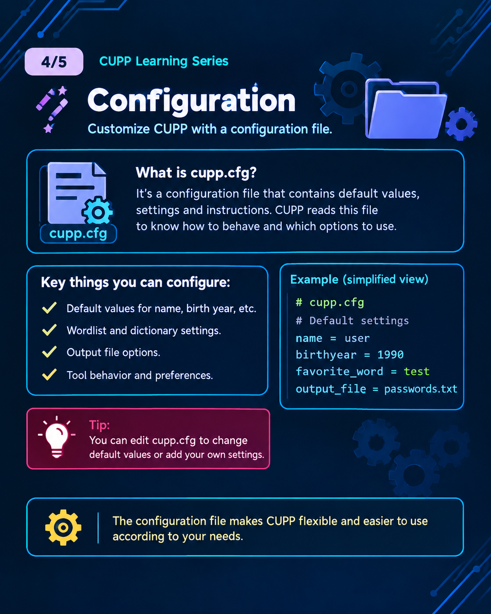
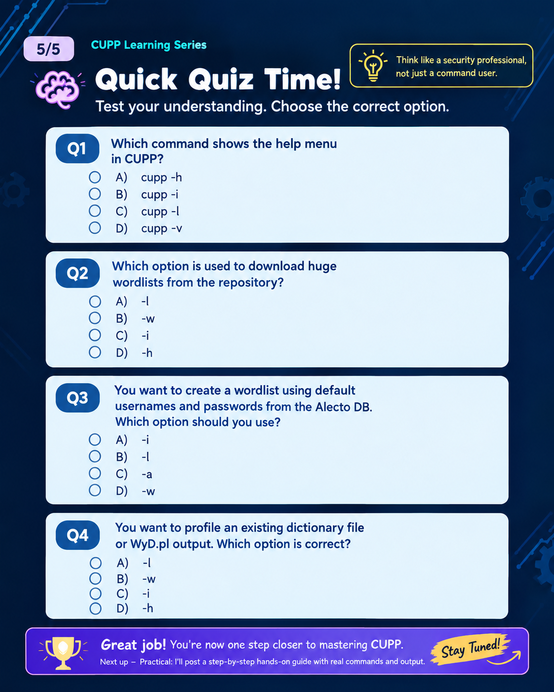

# 🔐 CUPP — Common User Passwords Profiler

Welcome to my CUPP learning repository!

This repository documents my cybersecurity learning journey as I explore CUPP, its command-line options, configuration, license, and interactive mode.

## 📚 Learning Materials

This repository includes five educational posters covering:

1. **Introduction to CUPP** — General information and purpose.
2. **Command-Line Options** — Explanations of options such as `-l`, `-h`, and `-i`.
3. **License** — Understanding CUPP's software license.
4. **Configuration** — Exploring configuration settings.
5. **Knowledge Check** — A multiple-choice quiz to review the concepts.

## 💻 Practical Demonstration

I also completed a practical exercise demonstrating CUPP's interactive mode, from entering fictional test information to generating and saving a password-candidate list.

## 🔗 LinkedIn Learning Series

I shared five educational posters on LinkedIn covering CUPP fundamentals, command-line options, licensing, configuration, and a knowledge-check quiz.

**📌 View my five-poster LinkedIn post:** [Read the post]https://lnkd.in/p/dd8JNQTJ

🎥 **Practical Demonstration:** https://lnkd.in/p/dGfZGsqp — an interactive CUPP practical showing the workflow in an authorized learning environment.

## 🎯 What I Learned

- The purpose and functionality of CUPP.
- How to understand its command-line options.
- The role of its configuration file.
- How interactive mode works.
- How the tool generates and saves password candidates.

---

## 🖼️ CUPP Visual Learning Posters

These five posters document my learning journey with CUPP (Common User Passwords Profiler), covering its purpose, command-line options, license, configuration, and a knowledge-check quiz.

### 1. Introduction to CUPP

An overview of CUPP, its purpose, and its role in password-auditing education.

### 2. CUPP Command-Line Options

A visual explanation of CUPP's command-line options and their purposes.

### 3. CUPP License

An introduction to CUPP's license and the importance of understanding open-source software licensing.

### 4. CUPP Configuration

An overview of CUPP configuration and why settings matter when working with the tool.

### 5. CUPP Knowledge Check

A quiz to review the concepts covered in the CUPP learning series.

## 🎯 Learning Objectives

- Understand CUPP's purpose and basic functionality.
- Learn about its command-line options.
- Understand software licensing and configuration.
- Reinforce learning through visual notes and a knowledge-check quiz.

These notes reflect my learning process and are shared for educational purposes.

## ⚠️ Ethical Use

This repository is intended for educational purposes and authorized security assessments. Use CUPP only in environments where you have permission to conduct testing. Do not use real people's personal information without authorization.

---

*Learning cybersecurity one concept and practical at a time.* 🔐
